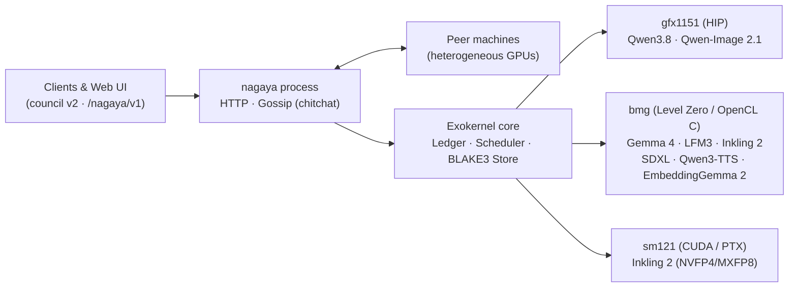

# 長屋 nagaya

A *nagaya* (長屋（ながや）) is a traditional Japanese row house: one building, several households, each with its own door. **nagaya** is the single process on each machine that owns the GPUs. Model engines live inside it, each behind its own door.

nagaya is three things:

- **An exokernel for megakernels.** Each engine runs a model pass as a persistent GPU kernel and keeps its own KV layout, recurrent state, quantization format, and kernels. nagaya never inspects or alters what a model computes—it governs device memory, host memory, NVMe, and GPU time across engines.
- **A Rust reference implementation.** A 30-crate Cargo workspace with custom megakernel engines across three GPU vendors (AMD HIP, Intel Level Zero / OpenCL C, and NVIDIA CUDA / PTX).
- **A [council v2](https://github.com/tobert/gogi) server.** Clients speak the council v2 protocol (defined by [gogi](https://github.com/tobert/gogi)) to any node in a cluster. Machine and lifecycle controls live under `/nagaya/v1`.



## What the API and kernels support

nagaya implements the [council v2](https://github.com/tobert/gogi) contract and exposes kernel-level capabilities that standard chat-completion servers hide:

- **Decision API & raw reads (`/council/v2/specs`, `/decisions`, `/reads`):** Define reusable question specs (up to 26 choices, free-text `describe`, and leave-one-out ablation) and read exact log-probabilities directly from model logits across up to 8 contexts in one call—no sampling noise or JSON-parsing hacks.
- **Generations, continuations & batched replies (`/council/v2/generations`):** Streaming and non-streaming generation with explicit `thinking` control, tool calling, parallel multi-reply fan-out (up to 8 replies per call in batched decode passes), and cheap continuation from saved snapshots.
- **Content-addressed contexts, snapshots & media (`/contexts`, `/snapshots`, `/objects`):** Build contexts with explicit `snap: true` boundaries, pin BLAKE3-addressed snapshots across restarts, and pass content-addressed media objects (`image/png`, `image/jpeg`, `audio/wav`, `video/mp4`, `video/webm`) with lease-based keeps.
- **Multimodal, image, speech & embeddings (`/generations`, `/embeddings`):** Native image generation (SDXL with inpainting/LoRA, Qwen-Image 2.1), speech synthesis (Qwen3-TTS, LFM3-Omni), multimodal vision/audio/video inputs, and task-conditioned Matryoshka embeddings (EmbeddingGemma 2 at 768/512/256/128 dims).
- **In-kernel steering, looping & interpretability (`/control-vectors`, `/nagaya/v1/lab/*`):**
  - **Control vectors:** Extract difference-of-means steering vectors from positive/negative context sets and apply them per-layer inside the forward pass.
  - **Layer loops & recurrent cycles:** Re-run spans of middle layers per token (`layer_loops` on LFM3) or adjust native recurrent reasoning depth (`cycles` 1–5 on Inkling 2).
  - **Lab inspection:** Logit-lens and J-Lens weight projections (`/lab/project`), per-step/per-layer traces (`/lab/trace`), ensembles (`/lab/ensemble`), vector composition (`/lab/compose`), soft inputs, and latent steps.

## Core design

- **Bit-exact determinism as a contract.** For a given engine identity and inputs, every run produces the exact same bits. Engine identity hashes weights, tokenizer, chat template, build, plan table lineage, and arithmetic settings; load-time canaries catch drift.
- **Explicit memory ledger.** Engines declare mandatory and elastic memory terms up front. The ledger admits allocations against configured tier budgets before any GPU memory is claimed—never by probing free VRAM.
- **Bounded-quantum scheduling.** Engines run in bounded quanta (`interactive`, `batch`, `filler`) and yield between them. Preempted contexts park bit-for-bit across device memory, host memory, and NVMe without altering downstream outputs.
- **Surviving weight arenas & chain joining.** Sealed snapshots are stored as canonical safetensors indexed by BLAKE3 content ID and recipe, with owner quotas and chain joining. On supported targets, weight arenas survive service restarts through systemd's file-descriptor store.
- **Heterogeneous clustering.** Nodes discover each other via UDP gossip (`chitchat`), share inventory and model status, and route council v2 requests transparently across AMD, Intel, and NVIDIA machines. Any node can serve as coordinator.

## Hardware targets & engines

| Target | Hardware & Runtime | Engines & Modalities |
|---|---|---|
| `gfx1151` | AMD Strix Halo (128 GB unified, HIP) | **Qwen3.8** (text, reasoning, tools, decisions, steering), **Qwen-Image 2.1** (images) |
| `bmg` | Intel Arc Pro B70 (Level Zero + OpenCL C interpreter) | **Gemma 4** (2-card pipeline), **LFM3 / LFM3-Omni** (text, vision, audio, video, speech, steering, layer loops), **Inkling 2** (recurrent-cycle reasoning, vision), **SDXL** (images, inpainting, LoRA), **Qwen3-TTS** (speech), **EmbeddingGemma 2** (embeddings) |
| `sm121` | NVIDIA DGX Spark / GB10 (128 GB unified, CUDA / PTX interpreter) | **Inkling 2** (native NVFP4/MXFP8, FP8 `e4m3` KV cache, 4×128K slots) |

Crate names follow `nagaya-<kind>-<model>-<target>`: `nagaya-mk-lfm3-bmg` is the B70 megakernel engine for LFM3, while `nagaya-family-lfm3` is its GPU-free family library (tokenizer, Jinja chat template, reply and tool-call parsers).

## Building & running

You need a current Rust toolchain. A default build compiles the workspace with no GPU, vendor SDK, or model files:

```sh
cargo build --release -p nagaya
```

That binary has no GPU engines enabled. It can serve only the CPU engine `mk-beatthis-cpu` (beat tracking, see `docs/spec.md` 11.19). Enable the feature for your hardware:

| Feature | Enables | Build requirements |
|---|---|---|
| `hip` | `gfx1151` engines | ROCm (`/opt/rocm`) with `clang++` |
| `xe` | `bmg` engines | Intel Level Zero loader and `ocloc` |
| `cuda` | `sm121` engines | CUDA Driver API (`libcuda`) and `nvcc` 13.2 (`sm_121a`) |
| `video` | Video inputs for LFM3-Omni | FFmpeg development libraries and `libclang` |

Example release builds:

```sh
cargo build --release -p nagaya --features hip        # AMD Strix Halo
cargo build --release -p nagaya --features xe,video   # Intel Arc Pro B70 pair
cargo build --release -p nagaya --features cuda       # NVIDIA DGX Spark (GB10)
```

See [`docs/deploy.md`](docs/deploy.md) for systemd user unit installation, bootstrap config (`nagaya.toml`), placement profiles (`profile.toml`), and rollback procedures. Ready-to-adapt examples live in `deploy/strix-halo/`, `deploy/b70-pair/`, and `deploy/dgx-spark/`.

## Web UI & tools

- **Web app (`tools/nagaya_web.py` + `tools/web/`):** A zero-dependency Python standard-library proxy and browser UI covering Chat, Images, Speech, Embeddings, Engine swaps, Steering, and Lab inspection across all nodes in a cluster:
  ```sh
  python3 tools/nagaya_web.py --seed http://192.0.2.10:8091
  ```
  To share it on a tailnet with a login, run it as `deploy/nagaya-web.service` behind `tailscale serve`; see [`docs/deploy.md`, "The web app"](docs/deploy.md#the-web-app).
- **Swarm driver (`tools/swarm/`):** Recipe-driven batch and multi-context execution driver against council v2.

## Repository layout

| Path | Contents |
|---|---|
| `crates/nagaya-abi`, `nagaya-ledger`, `nagaya-sched`, `nagaya-store`, `nagaya-telemetry`, `nagaya-conformance` | Pure-Rust exokernel core, memory ledger, scheduler, content-addressed store, OpenTelemetry export, and engine conformance suite |
| `crates/nagaya-council`, `nagaya-jinja`, `nagaya-family-*` (older ones still `nagaya-text-*`) | Council v2 request logic, Jinja2-compatible template engine, and GPU-free model family libraries |
| `crates/nagaya-mk-hip`, `nagaya-mk-bmg`, `nagaya-mk-cuda`, `crates/nagaya-mk-*-*` | Shared GPU interpreters and model-specific megakernel engines (HIP, OpenCL C, CUDA C++/PTX) |
| `crates/nagaya` | Main daemon: hardware inventory probe, device threads, HTTP server, gossip, systemd lifecycle |
| `deploy/` | Example configs, placement profiles, and systemd user units for Strix Halo, B70 pair, and DGX Spark |
| `tools/` | Web UI, swarm driver, Python reference oracles, and compiler stubs (`ocloc-stub`, `nvcc-stub`) |

**Where to start reading the code:**
1. [`crates/nagaya-abi/src/lib.rs`](crates/nagaya-abi/src/lib.rs) — The `Engine` trait and core ABI types.
2. [`crates/nagaya-ledger/src/lib.rs`](crates/nagaya-ledger/src/lib.rs) & [`crates/nagaya-sched/src/lib.rs`](crates/nagaya-sched/src/lib.rs) — Pure-Rust memory admission and quantum scheduling.
3. [`crates/nagaya/src/main.rs`](crates/nagaya/src/main.rs) — Process startup, arena restoration, telemetry, and lifecycle.
4. [`crates/nagaya-mk-bmg/kernels/megakernel.cl`](crates/nagaya-mk-bmg/kernels/megakernel.cl) or [`crates/nagaya-mk-cuda/kernels/megakernel.cu`](crates/nagaya-mk-cuda/kernels/megakernel.cu) — Persistent task-ring megakernel interpreters.

## Status & security

nagaya is an active research project running daily on a three-machine home lab (AMD Strix Halo, dual Intel Arc Pro B70, NVIDIA DGX Spark). The council v2 endpoints track [gogi](https://github.com/tobert/gogi); internal control routes under `/nagaya/v1` may change without notice.

**Network trust:** nagaya has **no authentication** on its HTTP or gossip ports. Bind `http_bind` and `gossip_bind` only to a private network or VPN (such as a tailnet) that you trust. `tools/nagaya_web.py` has no login by default either. With `--auth tailscale-serve` it binds only to loopback behind [`tailscale serve`](https://tailscale.com/kb/1312/serve) and answers each request without serve's `Tailscale-User-Login` with 401 (see its docstring). That gates the web app only: limit who reaches the nagaya ports with tailnet ACLs.

## Documentation

- [`docs/spec.md`](docs/spec.md) — Normative specification: architecture, inventory, ledger, scheduler, store, lifecycle, and API rules. Start here.
- [`docs/engine-abi.md`](docs/engine-abi.md) — The `Engine` trait, design decisions D1–D11, and how each target engine maps onto the ABI.
- [`docs/ontology.md`](docs/ontology.md) — Glossary of core terms (quantum, segment, ledger, term, recipe, arena, etc.).
- [`docs/deploy.md`](docs/deploy.md) — Building, installing, configuring, and operating nagaya as a systemd user service.
- [`docs/lab.md`](docs/lab.md) — Interpretability and research routes: control vectors, projections, lenses, traces, and layer loops.
- [`docs/new-engine.md`](docs/new-engine.md) — Checklist for adding a new engine, model family, card, or machine.
- [`AGENTS.md`](AGENTS.md) — Contributor and coding-agent guide: workspace rules, test suites, GPU test windows, and environment variables.

## License

Licensed under the [MIT License](LICENSE).
